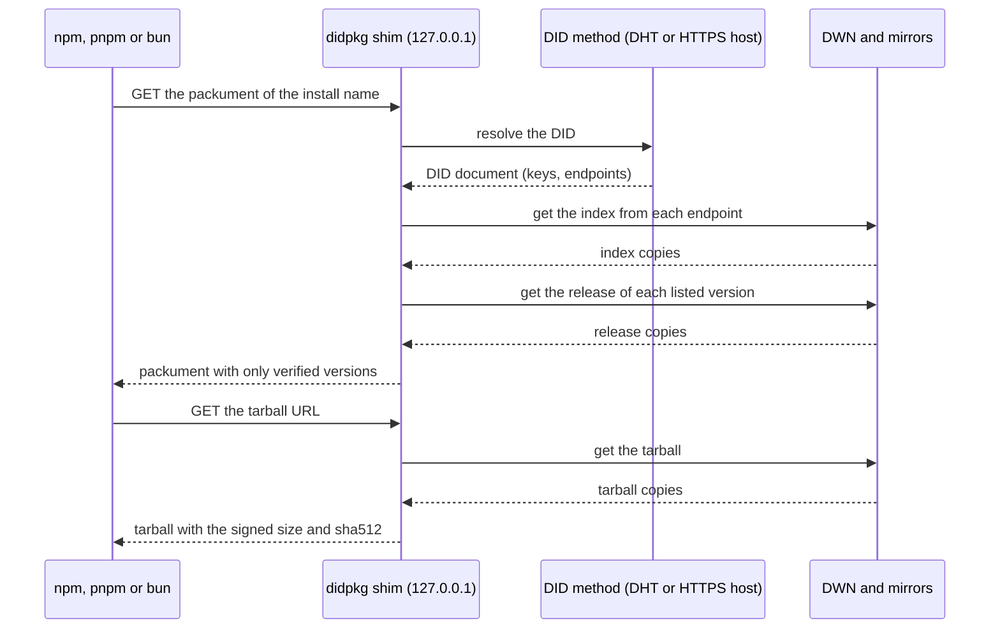

# How didpkg works

didpkg puts the trust in the DID of the publisher, not in the registry. The publisher signs each release with a key from its DID document. The storage only moves bytes. The shim on your computer checks each signature and each digest before npm gets a package.

## Parts

| Part | Made by | Location | Content |
|---|---|---|---|
| Publisher DID | `didpkg id create` | did:dht: the Mainline DHT, through Pkarr relays. did:web: `https://<host>/<path>/did.json`. | The release key `#didpkg-1` in `assertionMethod`. The storage endpoints: services of type `DecentralizedWebNode` and `DIDPackageRepository`. |
| Index | `didpkg publish` | Each storage endpoint | One for each package name: a `sequence` number, each version with the digest of its release and its status, and the dist-tags. Signed with `#didpkg-1`. |
| Release | `didpkg publish` | Each storage endpoint | One for each version: the npm fields, and the size and sha512 of the tarball. Signed with `#didpkg-1`. |
| Tarball | `npm pack` | Each storage endpoint | The package files. The tarball has no signature: the signed release holds its size and its sha512. |

The storage endpoints are of 2 kinds:

- A DWN (Decentralized Web Node) of the publisher, with the didpkg protocol v1. Example: `https://dwn.didpkg.dev`.
- A static HTTPS mirror with the layout `<name>/index.json`, `<name>/<version>.json` and `<name>/<version>.tgz`. Example: a GitHub Pages site.

Each endpoint holds the same signed bytes. Thus one endpoint can stop, and the install still works from the other endpoints.

## Diagram

## Checks at install

npm asks the shim for 2 files: the packument (the list of versions) and the tarball of one version.

For the packument, the shim does these steps:

1. Parse the install name into the DID and the package name. Refuse a DID on the denylist in [SECURITY.md](../SECURITY.md).
2. Resolve the DID. The DID document gives the keys and the storage endpoints, the DWN endpoints first.
3. Get the index from each endpoint at the same time. Check each copy: the schema, the publisher, the name, and a signature by a key that is in `assertionMethod` now. The valid copy with the highest `sequence` wins.
4. Compare the winner with the pin for this DID and name (see [Pins](#pins)).
5. Get the release of each `active` and `deprecated` version, by the digest in the index. Check the signature and the fields of each release. If one release fails, the packument fails, so a host cannot hide one version.
6. Send the packument. It does not list `yanked` and `revoked` versions.

For the tarball, the shim does these steps:

1. Do steps 1 to 4 again, and get the release of the version.
2. Get the tarball from the endpoints in order. The first copy with the size and the sha512 of the signed release wins.
3. Make sure that the `package.json` in the tarball has the package name and the version.
4. If the URL has `rec` (from a lockfile), make sure that it is the digest of the signed release.

A failed check stops the install with an HTTP error. The [quickstart](quickstart.md#errors) gives each status.

## Trust model

You trust these parts:

- The publisher, and the keys in its DID document.
- The DID method. A did:dht DID is a public key, and its DID document is a record that the key signs. A relay can hold back a record, but it cannot change a signed record. A did:web DID is as safe as its web host: the person who controls the DNS name and the TLS certificate controls the DID.
- The didpkg CLI that you install, from npm or from GitHub.

You do not trust these parts:

- The storage endpoints (the DWN and the mirrors). They can stop, they can serve old files, or they can serve bad files. A bad file fails a digest check or a signature check.
- The network path to the storage endpoints.

A did:dht publisher has 2 keys. The release key `#didpkg-1` signs the index and the releases. The update key `#0` changes the DID document. The shim refuses an index or a release that `#0` signs, so the publisher can keep `#0` offline.

## Pins

The shim pins the first index that it accepts for each DID and package name. This is trust on first use (TOFU). A later index must obey these rules:

| Rule | Code if the rule fails |
|---|---|
| A new key must have a co-signature by a pinned key. | `KEY_CHANGED` |
| Each pinned release must stay in the index, with the same digest. | `HISTORY_CHANGED` |
| With the same key, the `sequence` must not go down. | `ROLLBACK` |
| An index with the pinned `sequence` must be the pinned index. | `EQUIVOCATION` |

`KEY_CHANGED` and `HISTORY_CHANGED` obey the mode. In `--mode warn`, the shim writes a warning to its log and installs the package. In the default mode (`enforce`), the shim refuses the package. All other codes refuse the package in each mode.

Phase 1 keeps the pins in memory. When the shim stops, it forgets the pins.

## Limits

didpkg is a Phase 1 proof of concept. It had no security audit. These limits apply:

1. Each shim start is a first use, because the pins are in memory only. On first use, the shim accepts each valid index. If the DWN is down, a stale mirror can serve an older valid index.
2. Only the `@didpkg` packages go through the shim. The dependencies of a `@didpkg` package come from your usual registry, and didpkg does not check them.
3. The shim does not find 2 valid index copies with the same `sequence` and different content at read time. The pin finds them later (`EQUIVOCATION`).
4. A cold DWN read of a packument with more than about 110 versions fails with 502. The cause is the request rate limit of the DWN reader.
5. A hash-form install name needs a DID binding, which comes in Phase 2. The [install-name grammar](spec/install-names.md) is draft 1 and can change before 1.0.

## More

- [Install names](spec/install-names.md): the grammar, the codec and the test vectors.
- [Release records](spec/release-records.md): the signed objects, the digests, the proofs and the storage layout.
- [ADR 0003](adr/0003-storage-contract.md): the storage contract, the DWN protocol v1, the static layout v1 and the packument rules.
- [Deploy a DWN](deploy.md): the runbook of the demo DWN.
- [SECURITY.md](../SECURITY.md): how to report a vulnerability, and the denylist.
